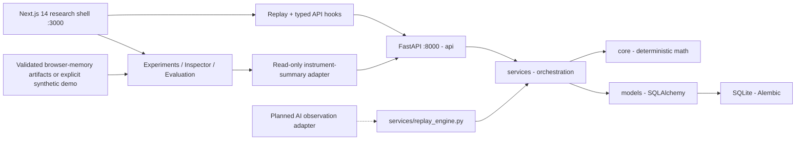
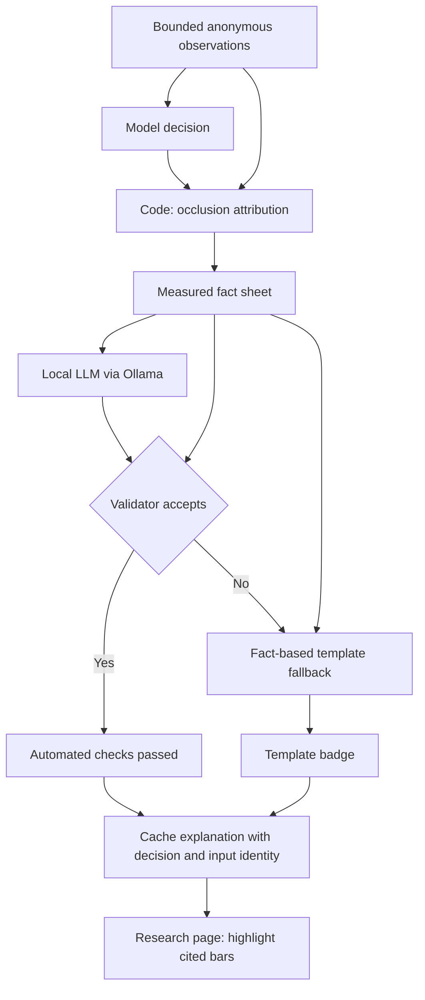

# Blind Replay Bench

`marketgpt-blind-replay` is a six-student Deep Learning & LLM course project:
compare a small Transformer trained on past returns (MarketGPT) with simple
players on unseen historical market periods, hiding tickers, dates and real
price levels. The repository currently contains a working local replay
foundation and an initial research cockpit; blind observations, models, evaluation
runners and real natural-language explanation generation are planned, not implemented.

**Educational simulation only: no real money, live broker or investment advice.**

The foundation was extracted from the personal project `market-replay-trading-lab`.
[PROVENANCE.md](PROVENANCE.md) records the source commit, copied/modified files,
new extraction files, dependency cuts and TODOs. That inventory defines inherited
work; subsequent work outside it is the team's course contribution. No market
datasets, source databases or trained weights are included.

## Research interface: first milestone

The default page is **Experiments**, with **Inspector**, **Evaluation**, and the
preserved **Replay** route in a shared light/dark, responsive shell.

| Page | Route | First-milestone capability |
| --- | --- | --- |
| Experiments | `/experiments` (default from `/`) | Run ledger, training/validation curves with missing-value handling, dataset/split/checkpoint identifiers |
| Inspector | `/inspector` | Saved prediction, model probabilities, bounded input features, explanation/template and fact sheet; execution stages kept separate |
| Evaluation | `/evaluation` | Saved report, retrospective misclassification and link back to the original Inspector sample; explicit unavailable aggregate metrics |
| Replay | `/replay` | Existing session, chart, order, portfolio and risk workflow; execution semantics unchanged |

**Try the connected example:** select **Load synthetic demo** → **Inspect prediction**
→ **Review saved evaluation** → the failure's **Inspector** link.
One deterministic bundle supplies the run, loss curve, prediction, explanation,
facts and outcome. The persistent banner identifies synthetic data.
No model was trained or called to produce this example.

Real mode defaults to honest unavailable research states, plus the existing
instrument-summary API in Experiments. **Import research JSON** accepts a proposed
version-1 integration contract, not an existing backend/exporter format:

- Maximum 2 MiB; schema version, collection bounds, finite numbers, probability
  ranges/sum and cross-references are validated before display.
- Imports stay in browser memory, are never uploaded, and disappear on reload.
  Selecting **Real mode** clears the loaded bundle. Imported origin/results are
  exporter declarations, not independently verified experimental evidence.
- Missing or invalid data never falls back to the demo. Failed imports clear
  previous evidence; stale imports cannot overwrite a newer source selection.
- `run`, `sample` and `report` query parameters identify selections. Shared links
  require the same artifact to be loaded; mismatched selections show a warning.
- Research imports never enter Replay observations. Imported text is displayed
  as text, not executable HTML.

See [research interface contracts, limitations and checks](docs/research-interface.md).
Explanation interface implemented; real LLM generation integration pending.
This milestone does not mark MarketGPT, F16 or evaluation as complete.
Run comparison/filtering, F1 provenance import, token inspection, attribution,
live LLM integration and full predictive/explanation evaluation remain deferred.

## Research questions and success

- **Primary:** on market periods it has never seen, with tickers and dates hidden,
  does MarketGPT make better decisions than simple rules without future data?
- **Secondary (planned F15):** does an LLM perform differently when dates are
  visible versus blind? This "memory-leak" experiment investigates sensitivity to
  historical context; a performance difference alone does not prove memorization.
- **Explanations (planned F16):** can a local LLM explain each model decision
  using only measured, verified facts?

Success means honest, reproducible measurement, **not beating the market**.
Losing to buy-and-hold is a valid result. Report uncertainty and limitations;
when a confidence interval for a difference includes zero, report
**"no measurable difference"**, not proof of equivalence.

## Current status

Status legend: ✅ done · 🚧 in progress · 📋 planned · ⏸ stretch.
No feature is labelled in progress without implementation evidence.
Pair assignments describe planned responsibility, not completed work.

### Extracted foundation

| Capability | Status | Evidence |
| --- | --- | --- |
| CSV validation/upload and instrument listing | ✅ done | [Market routes](backend/src/api/routes_market.py), [validator](backend/src/services/data_validator.py) |
| Session creation, visible bars, stepping and completion | ✅ done | [Replay engine](backend/src/services/replay_engine.py) |
| Market/limit/stop orders, protective OCO and reduction-only exits | ✅ done | [Broker](backend/src/services/broker.py), [OCO tests](backend/tests/test_oco.py) |
| Cash/futures accounting, fees, spread, positions and equity snapshots | ✅ done | [Portfolio service](backend/src/services/portfolio_service.py), [financial tests](backend/tests/test_financial_integrity.py) |
| Drawdown, Sharpe, trade win rate, expectancy and pre-trade risk limits | ✅ done | [Risk metrics](backend/src/core/risk_metrics.py), [risk limits](backend/src/core/risk_limits.py) |
| Minimal Next.js replay cockpit | ✅ done | [Replay page](frontend/app/replay/page.tsx) |
| Fresh migration, regression tests and CI configuration | ✅ done | [Baseline](backend/alembic/versions/0001_initial_replay_schema.py), [CI](.github/workflows/ci.yml) |

### Course features

Placeholder links below are evidence of reserved locations, **not implementations**.

| Feature | Level | Status | Owner pair | Evidence path / current boundary |
| --- | --- | --- | --- | --- |
| F1 Licensed data pipeline + data provenance | 1 | ✅ done | A | [Pipeline](backend/src/data/pipeline.py), [source adapter](backend/src/data/sources.py), [command](backend/src/data/download.py), [config](backend/config/data_sources.json), [offline tests](backend/tests/test_data_pipeline.py); yfinance use confirmed by the teacher 2026-11-16; first download (yfinance 1.8.0) passed every check for all 15 ETFs; data stays local |
| F2 Time split with gap | 1 | ✅ done | A | [Split module](backend/src/data/split.py), [config](backend/config/split.json), [split tests](backend/tests/test_split.py); F1 [pipeline](backend/src/data/pipeline.py) validates per-asset gaps and records split counts in provenance |
| F3 Anonymizer | 1 | 🚧 observation builder done; player wiring planned | A | [Anonymizer](backend/src/data/anonymizer.py): 64 adjusted-close log returns + bar offsets only, [tests](backend/tests/test_anonymizer.py) incl. future perturbation through the replay engine; [market routes](backend/src/api/routes_market.py) still expose identities/dates (not a blind API) |
| F4 Approximately 20 test scenarios | 1 | ✅ done (definitions and frozen manifests) | A | [Scenario rules](backend/config/scenarios.json), [generator](backend/src/data/scenarios.py), manifests ([development](backend/config/scenarios/development.json): 8; sealed [test](backend/config/scenarios/test.json): 24), [tests](backend/tests/test_scenarios.py), [contract](docs/benchmark.md); SPY + IEF two-asset case study; no results |
| F5 AI player through replay engine | 1 | 🚧 interface + execution adapter done; no players or runner | C | [Player interface](backend/src/ai/player.py), [execution adapter](backend/src/eval/execution.py), [benchmark profiles](backend/config/benchmark_profiles) (default benchmark-v2 with a 0.5% cash reserve), fill-time [affordability check](docs/fill_logic.md#fill-time-affordability-fill-time-cash-check-v1); [adapter tests](backend/tests/test_execution_adapter.py), [affordability tests](backend/tests/test_fill_affordability.py); synthetic only |
| F6 Buy-and-hold, MA crossover, MLP from scratch | 1 | 📋 planned | B | [AI placeholder](backend/src/ai/README.md) |
| F7 Evaluation runner | 1 | 📋 planned | C | [Evaluation placeholder](backend/src/eval/README.md); some [core metrics](backend/src/core/risk_metrics.py) exist |
| F8 Benchmark safety tests | 1 | 📋 planned; replay/data/scenario/observation subsets implemented | A + all pairs | [Replay invariants](backend/tests/test_no_lookahead.py), [pipeline tests](backend/tests/test_data_pipeline.py), [split tests](backend/tests/test_split.py), [scenario tests](backend/tests/test_scenarios.py), [observation tests](backend/tests/test_anonymizer.py); model/player benchmark safety remains planned |
| F9 Market tokenizer, approximately 32 return bins | 2 | 📋 planned | B | [AI placeholder](backend/src/ai/README.md) |
| F10 Small MarketGPT Transformer: long/flat + probability (MVP) | 2 | 📋 planned | B | [AI placeholder](backend/src/ai/README.md) |
| F11 LSTM | Stretch | ⏸ stretch | B | [AI placeholder](backend/src/ai/README.md) |
| F12 Training ablations, three seeds | 2 | 📋 planned | C; B support | [Evaluation placeholder](backend/src/eval/README.md) |
| F13 Calibration | 2 | 📋 planned | A; C support | [Evaluation placeholder](backend/src/eval/README.md) |
| F14 Research page | 2 | 🚧 first milestone | B | [Research interface](docs/research-interface.md): shell, validated artifact import and one connected synthetic workflow; full comparisons/evaluation deferred |
| F15 LLM memory-leak experiment | 3 | 📋 planned; gated on Level 2 | A | [Evaluation placeholder](backend/src/eval/README.md) |
| F16 Fact-grounded decision explanations | 2 | 📋 backend planned; initial UI implemented | B attribution; A LLM/validator | [Explanation interface](docs/research-interface.md); [AI placeholder](backend/src/ai/README.md), no live LLM, attribution or semantic validator |

## Quick start (Windows / PowerShell)

Prerequisites: Python >= 3.10, a current Node.js 20 patch with npm, and
PowerShell >= 5.1. CI specifies Python 3.11 and Node 20; historical local runtime
versions are recorded under Evaluation and Troubleshooting.
Run these commands from the repository root:

```powershell
.\start.ps1 -Install
.\start.ps1
```

The install command creates/uses the repository's own `.venv`, installs backend
runtime constraints and development extras, runs `npm ci`, then exits.
It never uses the source repository's editable installation. Installation needs
network access; it is separate from the offline-test requirement.

| Service/store | Default |
| --- | --- |
| Frontend | `http://localhost:3000` → `/experiments`; existing replay at `/replay` |
| Backend/API docs | `http://localhost:8000/docs` |
| Fresh database | `backend/data/db/trading_lab.sqlite`, created on first DB request |

If ports are occupied, do not stop unrelated services:

```powershell
.\start.ps1 -BackendPort 8100 -FrontendPort 3100
```

Configuration is implemented in [start.ps1](start.ps1),
[backend settings](backend/src/config.py) and [frontend constants](frontend/lib/constants.ts).

| Variable | Purpose |
| --- | --- |
| `NEXT_PUBLIC_API_BASE_URL` | Frontend's backend URL; launcher matches the backend port |
| `MRTL_FRONTEND_ORIGIN` | Optional extra CORS origin; launcher matches the frontend port |
| `MRTL_DATABASE_URL` | Override the SQLite URL for both application and migrations |
| `MRTL_PYTHON` | Optional Playwright backend interpreter override; CI sets it to `python` |
| `MRTL_NEXT_DIST_DIR` | Optional isolated Next.js output directory; default `.next`, E2E uses `.next-e2e` |

For manually launched processes, set the API URL and frontend origin consistently.
The original `localhost`/`127.0.0.1` port-3000 CORS origins remain allowed.
Keep legacy `MRTL_*` names and `trading_lab.sqlite`; do not rename them incidentally.

### Load local data

1. Obtain local CSVs whose terms permit the intended use. The F1 command
   `..\.venv\Scripts\python.exe -m src.data.download` (from `backend`, after
   `..\.venv\Scripts\python.exe -m pip install -e ".[data]"`) writes them to the git-ignored `backend/data/raw/yfinance/`
   with a `provenance.json`. It refuses to run until `terms_status` in
   [data_sources.json](backend/config/data_sources.json) is `approved` (yfinance use
   confirmed by the teacher for local educational use). No sample-data button or dataset is bundled.
2. Open API docs, select `POST /api/market/upload`, supply the `instrument` query
   parameter and upload the file. This is an operator workflow, not an AI observation.
3. Use UTF-8 CSV with `date,open,high,low,close,volume`; `adjusted_close` is optional.
   Dates must be strictly increasing and unique; rows must satisfy OHLC validation.
   The upload cap is 10 MiB. Invalid files are refused; already-loaded dates for
   the same instrument are rejected.
4. Open **Replay**, reload if needed, choose the instrument and range, then start a session.

The research demo does not seed the replay database. Market CSV upload and
browser-only research JSON import are separate workflows with different contracts.

Tests generate synthetic data; no CSV fixture is required. Never expose either
service to untrusted networks: authentication and multi-user isolation do not exist.

## Architecture



Target layering is `api/` (thin routers) → `services/` → `core/` (pure,
deterministic math). ORM belongs in persistence/orchestration, not new core math.
Known inherited deviations are **not patterns to copy**: market listing queries
ORM in its router; fill core imports a market schema; services use lazy imports
to resolve orchestration cycles. See [architecture](docs/architecture.md).

### One replay step

1. At visible bar N, submit an order through the order service; risk checks use
   visible information and the order waits.
2. Only [replay_engine.py](backend/src/services/replay_engine.py) advances the index.
3. [broker.py](backend/src/services/broker.py) processes eligible orders on the new
   bar; the portfolio service applies accounting and marks positions at its close.
4. Index advance, fills and snapshot commit together per bar; failure rolls that
   bar back. Multi-bar steps process every intermediate bar.
5. Risk checks can auto-pause; completion cancels pending orders.
6. Frontend mutations invalidate session, visible-bar, order, portfolio and risk queries.

**Planned AI boundary:** models, LLMs and explanations receive market observations
only through the replay engine's bounded interface and the future anonymizer,
never direct database/history access. Training-data preparation is a separate,
split-controlled offline workflow, not a bypass for live player observations.

## Execution and temporal integrity

The current bar is fully visible. Manual orders submitted at N cannot fill until
N+1 or later; market orders use the next open. Only the replay engine advances time.
The unrestricted `/api/market/bars/{instrument}` endpoint is absent and returns 404.

**Reference price is inside the fill bar's OHLC range. Executed price includes
synthetic spread and may lie outside that range.** Spread is not an observed quote;
commissions are separate cash flows. Limit orders still respect their limit.
No execution-price clamping was introduced during extraction.

**Fill-time affordability (2026-11-17, all sessions):** a cash-instrument opening
buy that the account cannot pay for at its executable price plus fees is now
rejected at fill time (`status = rejected`, `rejection_reason = INSUFFICIENT_CASH`)
with no fill, cash or position change; previously it could leave negative cash.
Exits and futures are unchanged. See [fill rules](docs/fill_logic.md#fill-time-affordability-fill-time-cash-check-v1).

Precommitted protection on a market entry can execute on the entry bar,
conservatively stop-first. Protection on limit/stop entries starts on a later bar.
Completion cancels pending orders but does not liquidate open positions.
Backward jumps are rejected; a same-index jump remains a no-op and does not reopen
a completed session. AI players must remain forward-only when implemented.

**AI player rule: decide on bar N, execute at N+1 or later, forward-only.**
Forward jumps are also rejected; advance using replay steps, not jumps.
Known naming issue: `test_jump_backward_allowed` in
[test_replay_engine.py](backend/tests/test_replay_engine.py) actually asserts
backward-jump rejection. Do not infer behavior from that name or stale comments;
it has not been renamed.

**Approved F7 terminal policy:** no forced liquidation. Score open positions at
the final bar's close using existing per-step mark-to-market, i.e. final equity.
The planned runner must reach the final bar consistently for all players.
Forced exits must never bypass N+1 execution. Unrealized P&L belongs in final
equity, not as an invented closed trade in trade win rate.

See [fill rules](docs/fill_logic.md) and [temporal integrity](docs/anti_lookahead.md).
Instrument names/dates are still visible: this is **not yet a blind-session API**.
Futures accounting relies on the `=F` suffix; anonymization must preserve the
accounting metadata, not merely rename symbols.

## Non-negotiable invariants

These are project requirements, not a claim that all future components are safe.
Existing tests cover replay, F1/F2 data handling and the first research-interface
milestone. They do not certify the planned models or live explanation pipeline.

| Invariant | Enforcement / test status |
| --- | --- |
| No API, model, tokenizer or explanation may use bars after the current index during a replay decision | Replay subset ✅: `test_api_never_returns_future_bars`, `test_chart_data_truncated_at_current_bar`, `test_order_cannot_reference_future_bar`, `test_risk_metrics_exclude_future_data` in [anti-lookahead tests](backend/tests/test_no_lookahead.py); `test_full_history_endpoint_is_not_exposed` in [market tests](backend/tests/test_routes_market.py). Model/tokenizer/explanation boundary: 📋 test planned. |
| Chronological train/validation/test split with a gap; test scenarios used once, at the end | Split ✅: dates in [split.json](backend/config/split.json). Each gap holds at least `label_horizon + embargo` bars; train/validation examples keep their whole window (look-back plus label) inside their set; test decisions may use pre-test bars as warm-up but are scored only from `test_start`. Rationale in [temporal integrity](docs/anti_lookahead.md#trainvalidationtest-split-f2), tests in [test_split.py](backend/tests/test_split.py). Single use of test scenarios: 📋 planned with F4/F7. |
| Tokenizer bins and normalization fitted on training data only | 📋 test planned |
| Blind observations expose no ticker, date or real price level | Observation builder ✅: field, date-shift, price-scale and future-perturbation tests in [test_anonymizer.py](backend/tests/test_anonymizer.py); reduces identity cues, does not guarantee a period is unrecognisable. Player wiring and blind API: 📋 planned |
| Code measures reasons, LLM phrases facts, validator checks output, template is fallback | 📋 test planned; F16 not implemented |
| Never commit market data, databases or model checkpoints | Exclusions in [.gitignore](.gitignore); repository-content enforcement: 📋 test planned. Ignore rules are not proof against forced additions. |
| Never weaken or skip tests; never lower the 85% coverage gate | Gate in [pyproject.toml](backend/pyproject.toml), run by [CI](.github/workflows/ci.yml); review protects test strength, automated anti-weakening check 📋 planned |
| Free/local only, no paid APIs; tests must run offline | Synthetic/local inputs exist; network-isolation enforcement 📋 planned. Download dependencies/browsers separately before tests. |

## Repository map

Tracked structure, two folder levels; ignored environments, build outputs and
runtime stores are omitted.

```text
marketgpt-blind-replay/
  .github/           automation
    workflows/      backend, frontend and E2E CI
  backend/          Python manifest, runtime lock and Alembic config
    alembic/        fresh baseline and migration environment
    config/         split boundaries (F2), scenario rules and frozen manifests (F4), no market data
    src/            application and future-work placeholders
    tests/          synthetic regression tests
  frontend/         Next.js manifest, lock and tooling configuration
    app/            root redirect, experiments, inspector, evaluation, replay
    components/     research shell/panels, replay cockpit and shared UI
    hooks/          session, order and portfolio queries
    lib/            API transport, research contract/adapters/demo, indicators
    __tests__/      replay smoke, artifact validation and research-state tests
    e2e/            replay, connected research and browser-import workflows
  docs/             architecture, integrity, fill rules, research contracts
```

Root files: [README.md](README.md), [PROVENANCE.md](PROVENANCE.md),
[start.ps1](start.ps1), [.gitignore](.gitignore).

| Within backend source | Responsibility |
| --- | --- |
| [api/](backend/src/api) | HTTP validation, errors and delegation |
| [services/](backend/src/services) | Replay, orders, portfolio, risk and loading |
| [core/](backend/src/core) | Deterministic fill, P&L and risk functions |
| [models/](backend/src/models) | Seven-table ORM |
| [schemas/](backend/src/schemas) | Request/response contracts |
| [ai/](backend/src/ai/README.md) | F5 player interface ✅ (binary long/flat); 📋 baselines, models, attribution, explainer |
| [data/](backend/src/data/README.md) | F1 download pipeline ✅, F2 split ✅, F4 scenarios ✅, F3 observation builder ✅; not a dataset store |
| [eval/](backend/src/eval/README.md) | F5 execution adapter ✅; 📋 benchmark runner |

## Data policy

- F1 is ✅ done. Source: yfinance daily bars for 15 ETFs (SPY QQQ IWM DIA,
  XLF XLE XLK XLV XLU, EFA EEM, IEF TLT LQD, GLD), listed in
  [data_sources.json](backend/config/data_sources.json). Stooq is a documented fallback
  only, not implemented. Terms: use confirmed by the teacher on 2026-11-16 for local
  educational use; the download command stays gated on `terms_status`. No redistribution:
  do not infer redistribution rights from download
  availability.
- **Two price representations, never mixed:** `open/high/low/close/volume` are kept
  exactly as downloaded (yfinance `auto_adjust=False`: split-adjusted by Yahoo, not
  dividend-adjusted) and are the only prices used for replay fills and accounting.
  `adjusted_close` (split- and dividend-adjusted) is a separate column, used only for
  return series in research and training. The pipeline rejects inconsistent adjustment:
  the factor `adjusted_close / close` must lie in (0, 1], never decrease, and never
  jump by more than a plausible dividend.
- Keep market data local and git-ignored; the repository contains no market dataset.
  Existing ignore rules cover CSV/Parquet and common database/weight formats.
- Each download writes `provenance.json`, which records the source and library version,
  terms status, download timestamp, adjustment convention, column roles, the requested
  period, the split config and, per ticker, the file's SHA-256 hash, row count, first and
  last dates, dropped rows and bars per split. Adjusted prices change with each new
  dividend, so the timestamp and hashes identify the exact data. Extraction
  [provenance](PROVENANCE.md) is not a dataset licence or data-quality certificate.
- Downloads are all-or-nothing: any ticker that fails validation, the adjustment checks
  or the F2 gap checks aborts the run and leaves previous data untouched.
- F2/F3 must prevent train/test contamination and anonymize observations without
  losing accounting metadata, including futures treatment and contract multiplier.
- **Blocker for real-data benchmark results:** observations use adjusted returns
  while replay accounting uses raw OHLC without distribution cash flows; an explicit
  split/distribution policy must be approved and tested first
  ([details](docs/benchmark.md#blocker-for-real-data-benchmark-results-corporate-actions)).
- Split dates, gaps and embargo are set in [split.json](backend/config/split.json).
  Benchmark scenarios are fixed calendar half-years for SPY and IEF
  ([rules and manifests](docs/benchmark.md)); the test manifest is sealed.

## Database

The fresh baseline contains exactly seven application tables:

`ohlcv_bars`, `replay_sessions`, `orders`, `fills`, `positions`,
`portfolio_snapshots`, `risk_limits`.

Alembic additionally maintains `alembic_version`. Source database files and old
source revision IDs are not supported. Do not point the target at a source DB.

From the repository root, after installation:

```powershell
Set-Location backend
..\.venv\Scripts\python.exe -m alembic upgrade head
..\.venv\Scripts\python.exe -m alembic check
Set-Location ..
```

The [Alembic environment](backend/alembic/env.py) uses application settings.
Set `MRTL_DATABASE_URL` before migration when using a non-default target.

## Models and explanations

All model work below is 📋 planned except explicitly marked stretch work.

| Component | Intended contract |
| --- | --- |
| F6 baselines | Buy-and-hold, moving-average crossover and MLP from scratch; same scenarios/execution rules |
| F9 tokenizer | Approximately 32 return bins; fit bins/normalization on training data only |
| F10 MarketGPT | Small Transformer trained on past returns; binary long/flat plus probability for the MVP (short is a later extension; no short probability is fabricated); sizing per [benchmark decisions](docs/benchmark.md#recorded-decisions-for-later-stages-not-implemented) |
| F12 ablations | SGD vs Adam, warmup/schedule, LayerNorm, dropout, weight decay and model size; at least four ablations, three seeds each |
| F13 calibration | Compare predicted long-class confidence with measured outcomes (binary long/flat); calibration plot and exact protocol TBD |
| F15 memory-leak experiment | Blind versus dated LLM observations with bootstrap confidence intervals; only after Level 2 |
| F11 and other extensions | ⏸ LSTM, attention maps, LoRA-tuned small explainer and Docker |

### F16: fact-grounded explanations (backend planned)

The Inspector already renders saved explanation text, a template baseline, facts
and recorded automated-check outcomes. These are imported records or explicitly
synthetic examples, not live generation or independently verified reasoning.
The pipeline below remains planned.



Proposed validator requirements: citations must identify visible bars only;
numbers, units and direction must match the measured fact sheet; reject unsupported
claims or identifying information in blind mode. Invalid output or unavailable
local inference must produce an explicit template fallback, never an invented
explanation. Exact tolerances, cache schema and failure diagnostics are TBD.
The LLM does not decide the reason: occlusion measures sensitivity, not a proven
causal explanation. Passing automated checks does not establish that the entire
explanation is true or that causality is proven.

## Evaluation and testing

### Existing validation commands

Start at the repository root, with dependencies installed and E2E ports free:

```powershell
Set-Location backend
..\.venv\Scripts\python.exe -m alembic upgrade head
..\.venv\Scripts\python.exe -m ruff check .
..\.venv\Scripts\python.exe -m pytest
Set-Location ..\frontend
npm run typecheck
npm run lint
npm test
npm run build
npx playwright install chromium
npm run e2e
Set-Location ..
```

E2E owns ports 3100/8100 and `.next-e2e`, never reuses existing servers, uses an
isolated SQLite file and shuts down its servers afterward:

- The unchanged Replay test uploads synthetic bars and checks API docs, removed
  history access, orders, portfolio/risk and completion.
- The connected research test checks default real mode, explicit demo activation,
  prediction/explanation/failure navigation, keyboard controls and page overflow.
  It captures all three research pages in light/dark themes at 1440px and 390px.
- The import test checks unavailable API data, rejected schema versions,
  text-only rendering, no upload requests and clearing on reload.

Screenshots are generated locally under `frontend/test-results/`; they are ignored
and not bundled in the repository. Test databases can be removed after the servers
stop. These checks are regressions, not experimental benchmark results.
The current configuration is
[playwright.config.ts](frontend/playwright.config.ts).

The backend **85% coverage gate is unchanged**. Tests must run offline once
dependencies/browsers are available; network-isolation enforcement is 📋 planned.
CI installation steps are not offline. Do not weaken assertions, skip failures or
add trivial coverage-filler tests to meet the threshold.

### Recorded research-milestone validation — 2026-11-16

Executed locally against the uncommitted first-milestone implementation, before
this README-only update:

| Check | Recorded result |
| --- | --- |
| `npm run typecheck` | Passed |
| `npm run lint` | Passed; no ESLint warnings/errors |
| `npm test` | 22 passed: 4 existing smoke tests and 18 research tests |
| `npm run build` | Passed with `MRTL_NEXT_DIST_DIR=.next-verify` |
| `npm run e2e` | 3 passed with `PW_DISABLE_TS_ESM=1` on installed Node 20.7.0 |
| Visual inspection | All 12 research screenshots inspected; narrow tables/chart labels corrected, no page-level horizontal overflow |

The default build initially hit a locked `.next/trace`; isolated output avoided
the unrelated running service. Playwright initially failed in the older Node ESM
loader; its existing CommonJS loader ran the full suite without dependency changes
or skipped tests. See Troubleshooting below.

Backend code/schema were unchanged and the backend unit suite was **not rerun**
for this milestone. Test servers stopped and generated test databases were removed.
These dated local results are not a CI report, current system-health indicator,
model evaluation or guarantee for subsequent edits.

### Historical extraction validation

**At extraction, target snapshot
`5dd4c35e7d77a5a3d9071801e75fe40e93c58f39`: 238 backend tests passed,
94.96% coverage; four frontend unit tests and one E2E passed.**
Validation was performed before the first target commit; this hash identifies
the recorded extraction snapshot, not a new test run. Source commit:
`baa6101e6d72a38660efdfe2121c725fa3da0ac1`.

[PROVENANCE.md](PROVENANCE.md) also records successful Ruff, frontend typecheck,
lint/build, fresh migration and Alembic schema check, and launcher HTTP checks.
Local backend validation used Python 3.12.13; only Python 3.12 was executed locally,
while CI specifies 3.11 and the declared minimum remains 3.10.
The six retained core anti-lookahead test functions were verified AST-identical
to the source. These records do not certify future features or every supported runtime.

For maintainers with `uv` available, regenerate the runtime lock from `backend`
without raising the declared Python minimum:

```powershell
uv pip compile --universal --python-version 3.10 pyproject.toml -o requirements.lock
```

### Planned benchmark contract

F7 must reuse existing deterministic math in `core/`; add missing metric math
there rather than duplicating formulas in the UI or LLM.

| Metric | Status and definition |
| --- | --- |
| Final equity / P&L | Per-step accounting ✅; runner 📋. Score at final close, including unrealized P&L; no forced liquidation |
| Maximum drawdown | Core calculation ✅; benchmark aggregation 📋 |
| Sharpe | Core calculation ✅: simple equity returns, sample standard deviation, **252 periods/year**, **zero risk-free rate**; undefined with insufficient observations or zero variance |
| Trade win rate | Existing `risk_metrics.win_rate` ✅: fraction of supplied trade P&Ls strictly positive; zero is not a win; undefined with no trades |
| Directional accuracy | 📋 model metric; target horizon, labels, flat-class treatment and denominator TBD |
| Difference versus buy-and-hold | 📋 runner comparison on identical scenarios and rules |

Report **trade win rate** and **directional accuracy** separately, never simply
"hit rate". Scenario frequency is TBD; the current Sharpe convention must not
silently be applied to a different bar frequency. Closed-trade aggregation must
be specified consistently; terminal marks must not fabricate closed trades.

Planned acceptance criteria:

- Safety tests pass in CI; every player uses the same scenarios, capital, costs,
  risk settings, observation bounds and final-equity policy.
- One command reproduces the results table within seed spread. **Benchmark command,
  results folder/schema and numerical tolerance: TBD / 📋 planned**, not runnable yet.
- Each run records commit, seed and configuration, with dataset/split/model identity.
  Test scenarios are evaluated once, at the end, not used to select configurations.
- At least four ablations × three seeds, loss curves and a calibration plot.
- Bootstrap confidence intervals; protocol/confidence level TBD. A difference
  interval including zero is reported as "no measurable difference".
- F16 metrics: **100% no-future-bar citations** as a target, numerical agreement,
  fallback rate, top-three cited-bar occlusion versus three random bars, and blind
  human ratings of LLM versus template explanations.
- Report limitations; live demo under three minutes plus a recorded backup.

## Roadmap

Everything in this roadmap is 📋 planned unless the status table says otherwise.

| Level | Commitment / gate |
| --- | --- |
| 1 - guaranteed scope | F1-F8; complete safe baseline measurement first |
| 2 - target | F9, F10, F12, F13, F14, F16 |
| 3 - conditional | F15 only if Level 2 is complete |
| Stretch | ⏸ F11 LSTM, attention maps, LoRA explainer, Docker |
| Out of scope | Real money, live trading, user accounts, live coaching, options/Greeks/VaR, paid APIs |

Approximately six weeks is a planning assumption; calendar dates are TBD.
Teacher approval of the project (W1) has been obtained.

| Week | Deliverables | Go/no-go |
| --- | --- | --- |
| W1 | Setup, teacher approval, common MLP learning sprint, data pipeline and split | Split tests pass |
| W2 | Anonymizer, AI player and baselines | Level 1 results table |
| W3 | Tokenizer and MarketGPT v1; mid-project handover | Preserve Level 1 behavior |
| W4 | Ablations, calibration, F16 and Research page | Level 2 complete; otherwise drop Level 3 |
| W5 | Conditional memory-leak experiment, error analysis | **Feature freeze at end of W5, one week before defense** |
| W6 | Report, slides, backup video and two rehearsals | Demo under three minutes; no new features |

## Team

Six students, three pairs, rotating once at mid-project. Names, deadline, defense
date and grading rubric: **TBD**. Exact rotation assignments are TBD; preserve
ownership through a one-hour handover.

| Pair | Initial responsibility | Later responsibility |
| --- | --- | --- |
| A | Data and integrity | Calibration, memory-leak experiment, F16 LLM/validator |
| B | Baselines, tokenizer, MarketGPT, occlusion attribution | Research page |
| C | AI player, training and evaluation runner | Ablations and error analysis |

Rituals: everyone trains the same MLP in W1; weekly 30-minute demo of running code
only; cross-pair review on every PR; one-hour rotation handover; end-of-W5 freeze.

**Definition of Done (team workflow):** acceptance behavior demonstrated, relevant
tests pass without weakening the gate, invariants checked, no data/weights/secrets
committed, documentation/status updated, reproducible configuration recorded where
applicable, and review by another pair. Planned features are not done merely
because a placeholder, screenshot or unverified result exists.

## Contribution workflow

Proposed conventions: short-lived `feat/<topic>`, `fix/<topic>` or `docs/<topic>`
branches; concise `feat:`, `fix:`, `docs:` or `test:` commit subjects. These are
team conventions, not automated repository enforcement.

PR checklist:

- [ ] Scope and assumptions stated; large changes approved first.
- [ ] Relevant tests, lint/type checks and build pass; no weakened/skipped tests.
- [ ] No lookahead, split leakage or anonymous-observation metadata leakage.
- [ ] No market data, databases, checkpoints, secrets or paid API dependencies.
- [ ] README/docs and feature status updated with real evidence.
- [ ] Results include seed/config/commit where applicable, never invented numbers.
- [ ] Reviewer from another pair; ownership/handover implications noted.

## Context for AI assistants

**Goal in three lines**

1. Build an educational blind historical-replay benchmark, not a live trading system.
2. Compare simple baselines and a small return-trained Transformer fairly.
3. Explain decisions from verified facts; honest negative results count as success.

**Current state:** replay/accounting/upload, the F1 download pipeline, F2 split,
F4 frozen scenario manifests, the F3 blind-observation builder and
the first research-cockpit milestone exist (market data is local-only, never in git).
The UI has three research pages, explicit demo mode and validated browser-memory
imports; real integration currently reads instrument summaries. The F5 player
interface and execution adapter exist; baseline players, models, benchmark runner,
attribution and live explanation generation do not; the MVP prediction task is
binary long/flat.
Saved/synthetic explanation UI is not F16 completion. Raw OHLC drives fills;
`adjusted_close` is only for returns. README-only folders are not implementations.
Treat this README as the project contract, then inspect code.

**Invariants:** no future observations; time splits with a gap; train-only fitting;
test scenarios used once at the end; no identity/date/real-price leakage in planned
blind mode; code measures explanations, local LLM phrases them, validator/template
handles output; no data/weights/secrets in git; no paid APIs; offline tests required
(enforcement planned); never weaken/skip tests or lower 85% coverage.

**Execution:** current bar N fully visible; decisions fill at N+1 or later, markets
at next open. Only the replay engine advances time. No forward/backward jumps;
same-index no-op does not reopen completion. Precommitted market-entry protection
may execute on entry bar, stop-first; limit/stop-entry protection starts later.
Reference price stays in OHLC; spread-adjusted execution can leave it; limits still
hold and commissions are separate. Completion cancels pending orders, never
liquidates. Final scoring uses final-close marked equity, not forced exits.
Preserve futures `=F` accounting metadata. Current API is not blind.

**Placement/layering:** thin `backend/src/api/` → `services/` → deterministic `core/`;
ORM in `models/`, contracts in `schemas/`. Put planned models/attribution/explainer
in `backend/src/ai/`, pipeline/anonymizer in `backend/src/data/`, runner in
`backend/src/eval/`. Models/LLMs never query full history or ORM for observations.
Known market-router ORM and core-schema imports are inherited exceptions, not new
design rules. Do not rename legacy environment variables, database names or the
misnamed backward-jump test incidentally.

**Checks:** from `backend`, run `..\.venv\Scripts\python.exe -m ruff check .` and
`..\.venv\Scripts\python.exe -m pytest`; after schema changes also run
`..\.venv\Scripts\python.exe -m alembic upgrade head` and
`..\.venv\Scripts\python.exe -m alembic check` on a target-only database.
From `frontend`, run `npm run typecheck`, `npm run lint`, `npm test`,
`npm run build` and relevant `npm run e2e` after browser installation.
E2E owns ports 3100/8100: stop your launcher first, never unrelated processes.

**Do not:** restore removed history endpoints/features, change execution/accounting
silently, use test scenarios for tuning, fetch paid services, invent results,
commit datasets/checkpoints, modify the source repository, or expose this app to
untrusted networks. State assumptions and **stop for approval before large changes**.
If an import/build fix requires behavioral changes, stop and ask.

Reusable session prompt:

```text
Read README.md as the project contract, then inspect code relevant to my task.
Distinguish implemented behavior from planned features and state assumptions.
Preserve temporal/accounting invariants, offline/local requirements and the 85%
coverage gate. Do not commit data, weights or secrets, or invent results.
Stop for approval before large changes or behavior-changing import/build fixes.
Implement only the agreed scope, run relevant checks, and report evidence and limits.
```

## Known limitations and responsible use

| Status | Limitation |
| --- | --- |
| Current | Instrument names, dates and real prices remain visible: not a blind-session API |
| Current | Synthetic spread can move execution outside OHLC; daily bars cannot resolve intrabar sequence |
| Current | Completion cancels pending orders without liquidation; benchmark terminal handling is not implemented, but final-close marking exists |
| Current | Futures margin, variation settlement and rolls are not simulated; `=F` metadata affects accounting |
| Current | Adjusted data, rolls and known historical outcomes can contaminate research without an API lookahead leak |
| Current | No authentication or multi-user isolation; a local operator can inspect the database |
| Current | Research exporters/backends are absent; built-in results and explanation are synthetic, imported records are exporter declarations |
| Current | Research imports disappear on reload; shared selection URLs do not transfer artifacts |
| Current | No machine-readable test report is loaded in the UI; recorded checks do not verify explanation truth |
| Current | Inherited dependency warnings, including Next.js 14.2.5, are recorded in provenance; not a hardened deployment |
| Current naming issue | `test_jump_backward_allowed` asserts rejection; its name is misleading |
| Anticipated F16 | Occlusion is an approximation, validation is heuristic, and local LLM CPU latency must be measured (TBD) |
| Anticipated F15 | Blind/dated differences alone cannot establish memorization as the cause |

Use locally for education and reproducible research only. A profitable replay,
passing test suite or "Automated checks passed" label is not evidence of real trading skill,
causal understanding or safe investment advice.

## Troubleshooting

- **Occupied ports:** choose alternate ports with the Quick start command; never
  kill unrelated services. E2E uses fixed 3100/8100 and refuses server reuse.
  Stop your own launcher before E2E; Ctrl+C stops its owned service processes.
- **Missing dependencies:** run `.\start.ps1 -Install` from the root. Do not use
  the source repository's editable Python installation.
- **Missing Chromium:** from `frontend`, run `npx playwright install chromium`
  while online, then run tests. Do not disable TLS verification to resolve downloads.
- **Locked Next output (`EPERM` on `.next/trace`):** do not stop unrelated services.
  From `frontend`, build in an isolated directory, then clear the override:

```powershell
$env:MRTL_NEXT_DIST_DIR = ".next-verify"
npm run build
Remove-Item Env:MRTL_NEXT_DIST_DIR
```

- **Node 20.7.0 Playwright `parentURL` / `ERR_INVALID_ARG_TYPE`:** the following
  was used for the research milestone. It selects Playwright's existing CommonJS
  TypeScript loader for this project, without downloads or dependency changes:

```powershell
$env:PW_DISABLE_TS_ESM = "1"
npm run e2e
Remove-Item Env:PW_DISABLE_TS_ESM
```

- **Older Node during extraction:** system Node 20.7.0 built the app but failed in
  Playwright's loader. Node 20.20.2 ran browser tests successfully at extraction.
  Prefer a current Node 20 patch. The historical isolated workaround below runs
  from `frontend`, without changing global Node, but may download Node and is not
  an offline-test guarantee:

```powershell
npm exec --yes --package=node@20 -- node node_modules\playwright\cli.js test
```

- **Empty instrument selector:** no data is bundled; upload a valid CSV through
  API docs and reload. Do not restore the removed full-history or seed endpoints.
- **No research data:** explicitly load the synthetic demo or import a research
  bundle matching the [proposed version-1 contract](docs/research-interface.md).
  F1 `provenance.json` is not a research bundle; its adapter is deferred.
  Re-import after reload before opening a shared run/sample/report URL.
- **Browser/API mismatch:** verify `NEXT_PUBLIC_API_BASE_URL` and
  `MRTL_FRONTEND_ORIGIN` match the selected ports; restart manually launched processes.

## Glossary

| Term | Meaning here |
| --- | --- |
| Lookahead | Using information unavailable at the current decision index |
| OHLC | Open, high, low and close prices of one bar |
| Drawdown | Decline in equity from its running peak |
| Sharpe | Mean return divided by return standard deviation, annualized under stated assumptions |
| OCO | One-cancels-other: filling one protective order cancels its sibling |
| Occlusion | Masking selected inputs and measuring how model output changes |
| Calibration | Agreement between predicted confidence and observed outcome frequencies |
| Bootstrap CI | Confidence interval estimated by resampling under a specified protocol |
| Blind replay | Sequential replay hiding identity, dates and real price level |
| Mark-to-market | Valuing open positions at the current mark without executing a closing trade |
| Trade win rate | Fraction of trade P&Ls strictly positive |
| Directional accuracy | Planned fraction of correctly predicted direction labels under a defined horizon/protocol |

## Links

- [Extraction provenance and TODOs](PROVENANCE.md)
- [Architecture and inherited layering exceptions](docs/architecture.md)
- [Temporal integrity](docs/anti_lookahead.md)
- [Fill, spread and protection rules](docs/fill_logic.md)
- [Research interface, proposed artifact contract and deferred features](docs/research-interface.md)
- [CI configuration](.github/workflows/ci.yml)

📋 Planned documentation, not existing files: licensed data/split protocol,
backend benchmark/exporter schema, model-training protocol and explanation validation
protocol. The proposed frontend research contract exists; it does not implement
those systems or provide a runnable benchmark command.

**Remaining TBDs:** team names; deadline/defense dates and rubric; rotation mapping;
data version policy for re-downloads; scenario frequency; exact
scenario set; model configuration, probability/sizing semantics and local LLM
licence/hardware; directional-accuracy labels/horizon and closed-trade aggregation;
bootstrap/calibration/faithfulness protocols; validator tolerances and cache schema;
results location/schema, reproduction command, seeds/configurations and tolerance.
