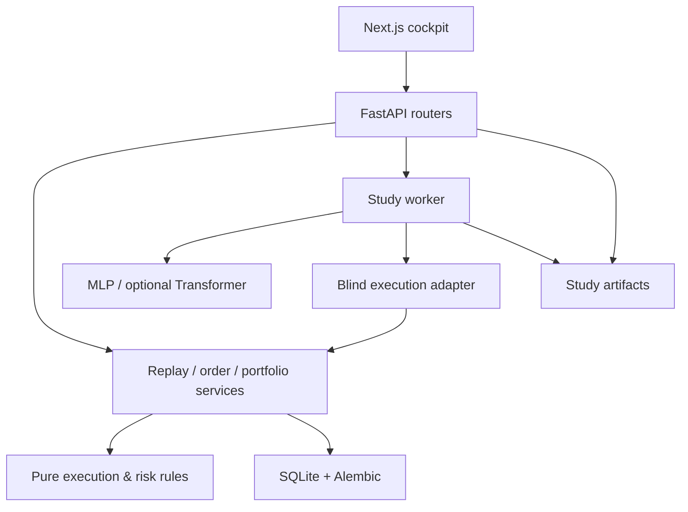

# Engineering architecture audit

**Baseline:** main, `f2533792cd501c5b5b8286d1bbe07624d0222755` (PR #8).
**Scope:** local educational Blind Replay Bench, including optional research workers,
cockpit, persistence, tests and delivery. Source and executable workflows, not the
README alone, were inspected. This is not a production penetration test or a
certification of financial-model performance.

## 1. Reconstructed architecture

At baseline Git tracks 207 files: 120 under backend, 75 under frontend, seven
documentation files, and repository/CI scripts. Python/FastAPI, Pydantic,
SQLAlchemy 2, SQLite/Alembic, pandas/NumPy and optional CPU PyTorch implement the
backend; Next.js 14, TypeScript, React 18, TanStack Query, Tailwind and chart
components implement the local cockpit.

| Layer or subsystem | Actual implementation / ownership |
|---|---|
| Composition | `backend/src/main.py:create_app` installs routers, CORS, gzip, error handling and request logging. `config.py` uses environment-backed local settings. |
| API | `src/api/routes_{market,replay,orders,portfolio,risk,studies,jury}.py`; dependency-created SQLAlchemy sessions; Pydantic request/response schemas; study JSON contracts. |
| Simulation | `src/services/replay_engine.py` owns bar pointer/status; `broker.py` drives fills, `portfolio_service.py` persists positions/snapshots, `order_service.py` validates submissions, risk services apply limits. |
| Pure domain rules | `src/core/fill_logic.py`, `pnl.py`, `risk_metrics.py`; no dependency on React or HTTP. |
| Persistence | `src/models/*`, `database.py`, Alembic revisions 0001/0002; market bars, replay sessions, orders, fills, portfolio/risk state; SQLite file with WAL, isolated in-memory engine for research. |
| Data | `src/data/pipeline.py` downloads through the source adapter, verifies adjustment, produces CSV/provenance; `split.py` enforces ordered partitions and embargo; `data_validator.py` and `data_loader.py` validate uploaded OHLCV and refuse conflicting dates. |
| AI | `src/ai/player.py`, baselines, anonymizer, numeric tokenizer. NumPy MLP teaching scripts `learning/mlp/step*.py`; optional PyTorch encoder `transformer_reference.py`. |
| Evaluation | `src/eval/execution.py` maps blind observations to deterministic order submissions and resolves outcome on the next bar; scenarios and metrics support evaluation. `export_comparison.py` trains, replays and emits trace/curves/checkpoint metadata. |
| Research orchestration | `routes_studies.py` starts one local subprocess `run_study.py`; per-study directory holds config, status, timeline, reports, checkpoints, catalog entries and human-study results. Jury votes use a separate per-study SQLite table with a conditional update. |
| UI | `frontend/app` routes for home, replay, studies, comparison, experiments, evaluation, inspector and jury; shared AppShell and research plots; React Query fetches saved studies and manual replay resources. Browser-imported research bundles are local state (distinct from server-saved studies). |
| Integration | Optional yfinance data, local GGUF/Ollama explanation provider; no live broker or financial execution integration. |
| Delivery | `start.ps1` installs/starts local backend+frontend, Alembic migrations; `.github/workflows/ci.yml` checks backend, frontend and Playwright with screenshots; package-lock and Python requirements constraints. |

Important workflow: the same simulation services power manual replay and the
recorded AI experiments, rather than maintaining a second accounting engine.
Worker output is validation evidence, not a real-time autonomous trading service.

```mermaid
sequenceDiagram
  participant W as Study worker
  participant A as AI player
  participant E as Execution adapter
  participant S as Replay services
  W->>S: Start validation session
  loop Each decision bar
    E->>S: Read visible history
    E->>A: Anonymized observation
    A-->>E: Target / probability
    E->>S: Submit bounded order
    W->>S: Advance one bar
    S->>S: Fill, mark, commit snapshot
    E->>S: Resolve recorded outcome
  end
  W->>W: Publish trace and checkpoint metadata
```

Manual route flows: create session → initial snapshot → submit pending order →
step through each intervening bar → broker and portfolio transaction → completion
or drawdown pause. API errors are translated by `api/errors.py` and main's
request middleware. A jury-only listener exposes challenge/vote rather than
study/trace endpoints; this is deployment isolation, not general-purpose auth.

## 2. Baseline and strengths

An existing local worktree had unrelated user changes. The audit used a clean
isolated feature worktree built from current main; no unrelated changes entered
the patch. Baseline executed before modifications with Python 3.12.14, Node
24.22.3, cached dependencies (CI targets Python 3.11 / Node 20).

| Check | Baseline |
|---|---|
| Backend Ruff | Pass |
| Alembic upgrade / check | Pass, revision 0002, no schema drift |
| Backend pytest | 432 passed, 92.72% coverage (85% gate), 12 warnings |
| Frontend types / lint / build | Pass |
| Vitest | 25 passed |
| Browser E2E | 9 passed; manual, import, studies, jury-related research and responsive themes |
| Optional Black check | 39 files would be reformatted; not a CI gate |
| Optional strict mypy | 251 errors in 26 files; not a CI gate |

Preserve pure execution math, Pydantic validation, train-only feature fitting,
chronological and holdout guards, next-bar fills, per-bar rollback, conditional
jury vote update, bounded CSV ingestion, existing provenance, GZip/CORS,
request logging and broad domain/regression coverage. Both browser import
contracts already check structural limits and finite numeric values. The
existing architecture is appropriate for the intended local scope; there is no
evidence that microservices, a new database or a generic repository framework
would improve it.

## 3. Traceable findings

Evidence describes the baseline (before fixes). Severity rates impact within
the intended deployment, not a hypothetical public service. Effort S/M/L is
relative to this repository.

| ID / category / severity | Exact evidence and root cause | Impact | Recommendation / confidence | Regression risk / effort |
|---|---|---|---|---|
| F01 Reliability — High | `replay_engine.create_session` committed session before `portfolio_service.initialize_session` committed its snapshot; split transaction. | Failure leaves a partially initialized durable session. | One transaction, rollback on initialization failure; confirmed. | Low; S |
| F02 Reliability — High | `routes_studies.start/status`, `learning/mlp/run_study.py`: non-atomic initial files, launch errors leave queued status, interrupted/failed counters reset to zero, reader can see queued before worker registration. | Misleading progress and failures; partial work difficult to recover. | Atomic publication, synchronized status, durable launch failure and preserved progress; confirmed. | Medium; M |
| F03 Correctness — High | `run_study.work` loads split for timeline, `export_comparison.export` reloads split and benchmark profile for each run. | Changing configuration during a multi-run study can mix settings; comparison rejects mismatches only later. | Freeze both validated settings once per worker; confirmed dependency behavior, no assertion that historical runs are mixed. | Low; S |
| F04 Performance/architecture — Medium | `routes_studies.overview` globbed and decoded entire reports, scanned cases for accuracy, even though UI polls every 2s. `report` and runner independently enumerate run keys. | Per poll O(total trace size) deserialization and duplicated contract knowledge. Synthetic E2E report 1,350,040 bytes. | Publish derived overview sidecar, legacy fallback, shared artifact boundary and run identity; confirmed. | Medium; M |
| F05 Performance — Medium | `replay_engine.get_visible_bars/_ordered_bars` read full session then sliced; `broker._ordered_bars` and `portfolio_service._marks_at_bar/session_bars` materialized full history to obtain one bar. | O(N) ORM row materialization every step/mark even for one row; unnecessary future data in memory. | SQL LIMIT for visible prefix; shared ordered single-bar lookup; confirmed complexity (not an end-to-end speed claim). | Medium; M |
| F06 Reliability/UI — Medium | `CompetitionReplay.tsx:Replay` computes independent decision/outcome/market boundaries; competition cache key did not include newly published runs and polling stopped at complete, continued on failure/interruption. | Stale partial competition after final run, repeated reads on terminal failures; risk of off-by-one changes. | Small tested clock and selected-run signature; confirmed logic, no claim historical data leaked. | Medium; M |
| F07 UI — Low | `app/studies/page.tsx:Results` retains selected period when run changes, though periods are run-specific. | Empty metrics for a prior period not present in current run. | Scope filtering state to run identity; confirmed. | Low; S |
| F08 Testing / dependency — High | `ci.yml` installs only dev extras; `transformer_reference.fit_transformer` imports torch lazily. NumPy is directly imported throughout learning code but not declared in project dependencies. | Main CI did not execute the optional reference model; accidental transitive dependency. | CPU smoke job exercising every variant, explicit NumPy requirement, migration drift check; confirmed. | Low–medium; M |
| F09 Architecture — Medium | `routes_studies.py` combines worker lifecycle, reports, explanation transport, evaluation, and jury. `CompetitionReplay.tsx` >1,000 lines, `studies/page.tsx` >850 lines. | Several unrelated reasons to change; limited isolated testing of presentation and provider logic. | First extract shared artifacts, clock and local provider orchestration (F04/F06/A09); remaining decomposition only with contract characterization; confirmed maintainability debt. | Medium; M/L |
| F10 Reliability/operations — High (conditional) | `database.py` uses request-scoped sessions and SQLite WAL, while `replay_engine.step_session` and `order_service` read/update session state independently; study lock is process-local. | Concurrent mutating requests or multiple API worker processes have no documented serialization contract. | Define supported concurrency and stress-test legitimate concurrent actions before changing transactions; source risk confirmed, actual schedules require validation. | High; L |
| F11 Security/operations — High (if exposed) | `main.create_app` local CORS, no app auth; `start.ps1` local Uvicorn, jury separate listener; no public deployment infrastructure. | Not suitable for untrusted clients or public exposure; CORS does not provide auth. | Keep loopback-only; if deployment scope changes, first design auth, isolation, resource quotas, backups and transport protections. Confirmed scope limitation. | High; L |
| F12 Engineering quality — Medium | Strict mypy and Black configured but optional; measured failures above; frontend lock includes old pinned dependencies. | Static checking gap and dependency maintenance burden. | Incremental typing/formatting, fresh advisory review and reproducible upgrade branch; confirmed quality backlog, advisory status separately unresolved. | Medium; L |

## 4. Debt inventory and limits

- **Correctness/reliability:** F01/F02/F03/F06; F10 requires concurrency design,
  not a speculative lock around every function.
- **Structural/maintainability:** F04/F09, duplicated bar queries F05; keep the
  domain implementation, improve high-churn boundaries.
- **Testing/supply chain:** F08/F12; scope of optional GGUF/Ollama, actual
  yfinance downloads and remote CI still needs environment-specific validation.
- **Performance:** F04/F05 demonstrably reduce deserialization/materialization;
  other history scans (e.g. portfolio drawdown) require profiling before
  optimizing; no latency target or throughput improvement inferred.
- **Security:** bounded Pydantic/CSV inputs, UUID study paths, configured run
  keys, parameterized SQLite queries, local-only explanation and no secrets
  introduced in patch. Auth is intentionally absent; actual dependency
  advisory verification is not equivalent to `pip check`. No attack
  reproduction, production access, or external service tests were performed.
- **Unchanged intentionally:** financial assumptions/fee/risk profile values,
  model architecture and hyperparameters, database schema, full study report
  and existing catalog formats, jury schema, browser imports and styling.
  Do not treat educational validation performance as proof of future returns.

See [action plan](REFACTORING_ACTION_PLAN.md) and
[implementation report](IMPLEMENTATION_REPORT.md) for delivery and status.
