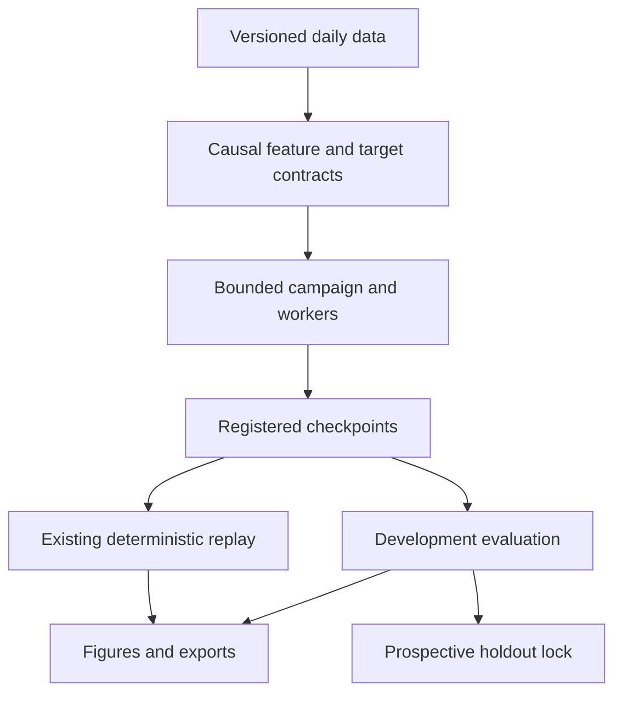

# Blind Replay Bench — research laboratory

**Product:** a local, reproducible financial AI experiment laboratory. Success
means a defensible measurement, including negative results, not hypothetical
profitability.

Open the application's root to enter the laboratory. The six views share a
campaign and run selection: Overview, Data, Training, Evaluation, Replay,
Explainability. Existing saved studies and imported research reports remain
accessible as legacy/educational workflows.

## Workflow

The existing T1–T7 implementations on main supplied features, datasets, targets,
MLP, orchestration and statistical baselines. This modernization connects those
to an automated workflow, adds bounded HPO and registered Transformer, hardens
walk-forward selection and data identity, and builds the scientific cockpit.

See [protocol](RESEARCH_PROTOCOL.md), [experiment catalog](EXPERIMENT_CATALOG.md),
[backlog](../engineering/IMPLEMENTATION_BACKLOG.md), and [results](RESULTS_AND_CONCLUSIONS.md).

Scope: daily educational simulation; no live trading or investment advice.
No result should be interpreted as a guarantee of future returns.
