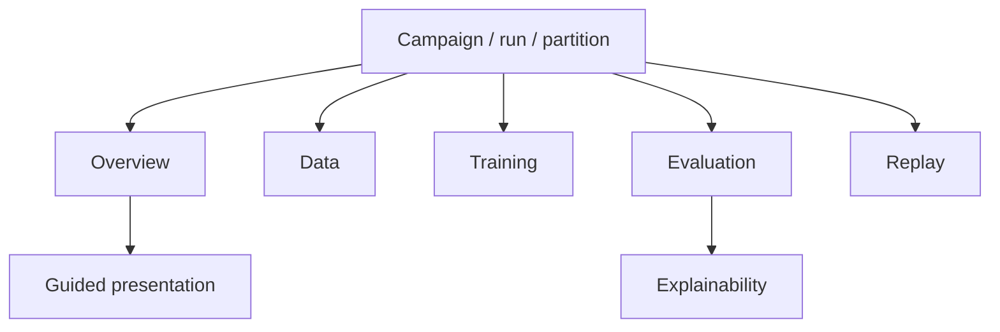

# Information architecture

The URL is the shared context. Campaign changes clear run, result, asset and playback selections. Run or partition changes clear dependent evidence and playback. Evaluation entries use a feature/profile/target key and match the retained run's seed. Replay asset and cursor are separate from the conceptual data-source preview. Presentation exit returns to the corresponding detailed laboratory. Legacy and imported tools remain in a disclosure group; direct routes remain compatible.
